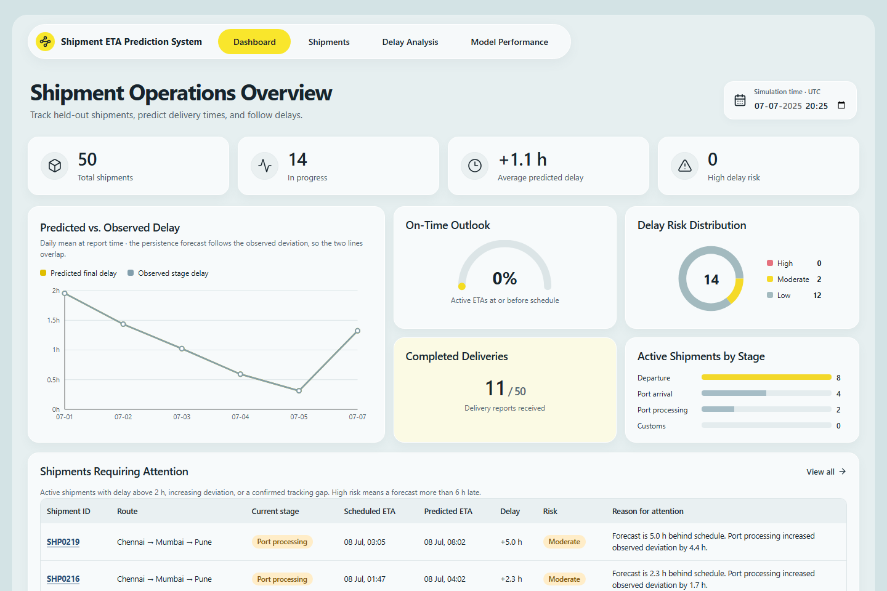
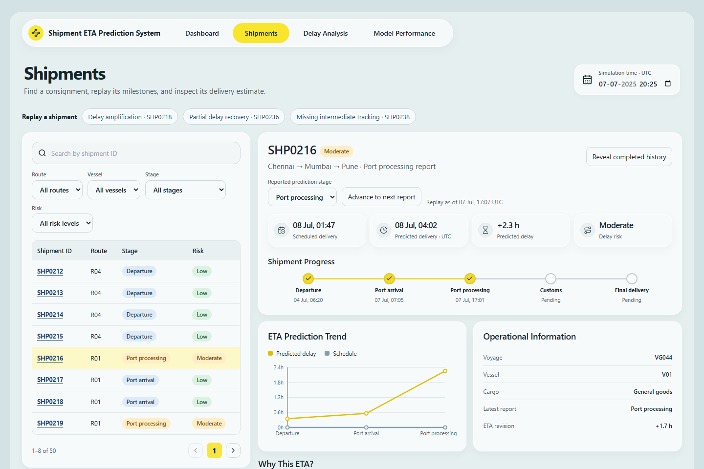
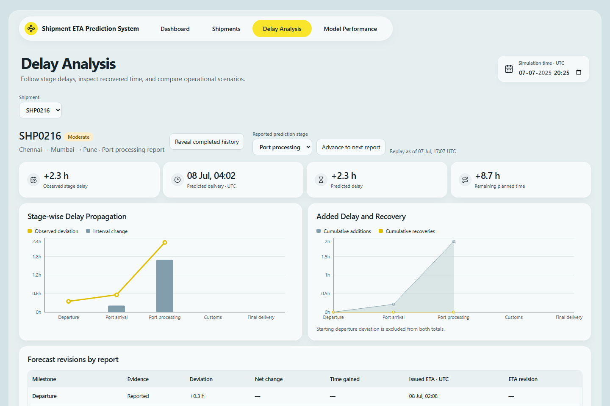

# Shipment ETA Prediction System

A shipment tracking and delivery forecasting application that estimates final arrival times, monitors delays, and explains how changes at different logistics stages affect the expected delivery time.

The project combines shipment tracking data, operational delay calculations, machine learning models, and an interactive dashboard. It focuses on understanding how delays develop during transportation and how delivery estimates change when new tracking information becomes available.

## Overview

A shipment passes through several stages before reaching its final destination. Delays at departure, port arrival, cargo handling, customs clearance, or inland transportation can affect the final delivery time.

A delay at one stage does not always result in an equally late delivery. Some time may be recovered during later operations, while congestion or additional processing may increase the delay.

This system tracks those changes and updates the expected final delivery time using the information available at each reported milestone.

### Main capabilities

- Predict the final estimated arrival time of a shipment.
- Calculate expected delay in hours.
- Classify predicted delay into low, moderate, or high categories.
- Track accumulated delay across shipment milestones.
- Identify additional delay and recovered time.
- Explain important operational factors behind the forecast.
- Handle missing intermediate tracking reports.
- Compare prediction methods using validation and test results.
- Explore route variation, congestion, and processing behavior.
- Replay historical shipment journeys without revealing future information.

## Technology Stack

| Component | Technology |
|---|---|
| Programming language | Python 3.11 |
| Backend | FastAPI, Pydantic |
| Data processing | pandas, NumPy |
| Machine learning | scikit-learn, XGBoost, CatBoost |
| Model optimization | Optuna |
| Model storage | joblib |
| Frontend | React, TypeScript, Vite |
| Styling | Tailwind CSS, custom CSS |
| Charts | Recharts |
| Animations | Framer Motion |
| Testing | pytest, Vitest, Playwright |

The application uses CSV files and saved model artifacts. A database is not required for the current implementation.

## Project Structure

```text
Shipment ETA Prediction System/
│
├── data/
│   ├── raw/                 Shipment, voyage, and tracking data
│   ├── ground_truth/        Complete simulated milestone records
│   ├── processed/           Prediction snapshots and split assignments
│   └── metadata/            Dataset configuration and feature definitions
│
├── models/
│   ├── comparison/          Model comparison artifacts
│   └── tuning/              Optimized models and evaluation results
│
├── src/
│   ├── backend/             API and prediction services
│   ├── data_generation/     Synthetic data and feature construction
│   └── ml/                  Model training, inference, and evaluation
│
├── frontend/
│   ├── src/                 React application
│   └── e2e/                 Browser tests
│
├── scripts/                 Data, model, and reporting utilities
├── tests/                   Python automated tests
│
├── reports/
│   ├── screenshots/
│   ├── architecture.md
│   ├── dataset_validation.md
│   ├── demonstration_guide.md
│   ├── model_comparison.md
│   ├── tuning_comparison.md
│   ├── quality_checks.md
│   └── Shipment ETA Prediction System - Technical Report.pdf
│
├── DEMO_GUIDE.md
├── requirements.txt
├── requirements-tuning.txt
└── README.md
```

## Dataset

The project uses a reproducible synthetic logistics dataset containing:

| Description | Count |
|---|---:|
| Shipments | 250 |
| Vessel voyages | 50 |
| Vessels | 10 |
| Routes | 5 |
| Shipment milestones | 5 |
| Prediction snapshots | 927 |
| Model input features | 28 |

Multiple shipments can travel on the same vessel voyage. These shipments share vessel-level events, including departure and destination-port arrival, while cargo processing, customs, and inland delivery can vary between shipments.

### Shipment milestones

1. Origin departure
2. Destination port arrival
3. Port processing completion
4. Customs clearance completion
5. Final delivery

The dataset includes planned schedules, actual event times, weather conditions, congestion measurements, operational delays, and missing tracking reports.

The complete physical timeline is retained separately from the reports visible to the forecasting system.

For additional details, see [Dataset Validation](reports/dataset_validation.md).

## ETA Prediction

The system calculates final delivery delay as:

```text
Final Delay = Actual Final Delivery - Scheduled Final Delivery
```

A positive value indicates late delivery. A negative value indicates early delivery.

The predicted arrival time is calculated as:

```text
Predicted ETA = Scheduled Final Delivery + Predicted Delay
```

The operational forecast uses the latest observed schedule deviation. Random Forest, XGBoost, and CatBoost provide additional model-based comparisons.

### Delay categories

| Category | Predicted delay |
|---|---|
| Low | Up to 2 hours late |
| Moderate | More than 2 and up to 6 hours late |
| High | More than 6 hours late |

These categories describe predicted delay magnitude. They are not probabilities or model confidence scores.

## Installation and Setup

The application was verified using:

- Python 3.11.5 (64-bit)
- Node.js 22.17.1
- npm 10.9.2

Using the specified versions is recommended because the saved model artifacts depend on compatible Python libraries.

### Windows — Step 1: Open the project

Extract the ZIP file and open PowerShell in the extracted project directory.

```powershell
cd "Shipment ETA Prediction System"
```

If using Git, clone the repository and open its project directory instead.

### Step 2: Create a Python environment

```powershell
python --version
python -m venv .venv
```

Activate the environment:

```powershell
.\.venv\Scripts\Activate.ps1
```

### Step 3: Install backend dependencies

```powershell
python -m pip install -r requirements-tuning.txt
python -m pip check
```

The tuning requirements include the dependencies needed to load all saved comparison models.

### Step 4: Verify model loading

```powershell
python -m pytest -q tests/test_forecast_models.py
```

This checks that the saved prediction models can load and reproduce recorded outputs.

### Step 5: Start the backend

```powershell
python -m uvicorn backend.main:app --app-dir src --host 127.0.0.1 --port 8036
```

Keep this terminal running.

Backend API documentation:

http://127.0.0.1:8036/docs

Health endpoint:

http://127.0.0.1:8036/api/health

### Step 6: Start the frontend

Open a second terminal in the project directory.

```powershell
cd frontend
npm.cmd ci
```

Start the development server:

```powershell
$env:SHIPMENT_API_ORIGIN = 'http://127.0.0.1:8036'
npm.cmd run dev -- --host 127.0.0.1 --port 5236 --strictPort
```

Keep this terminal running.

### Step 7: Open the application

Visit:

http://127.0.0.1:5236/dashboard

The dashboard should load shipment information from the FastAPI backend.

### macOS and Linux

From the extracted project directory:

```bash
python3.11 -m venv .venv
source .venv/bin/activate
python -m pip install -r requirements-tuning.txt
python -m pip check

python -m uvicorn backend.main:app --app-dir src --host 127.0.0.1 --port 8036
```

Open another terminal:

```bash
cd frontend
npm ci
SHIPMENT_API_ORIGIN=http://127.0.0.1:8036 npm run dev -- --host 127.0.0.1 --port 5236 --strictPort
```

## Using the Application

The frontend contains four sections.

### Dashboard

Provides an overview of shipments currently being monitored.

Displays:

- Total shipments
- Active shipments
- Average predicted delay
- High-delay-risk shipments
- On-time outlook
- Delay-risk distribution
- Shipment progress
- Shipments requiring attention

The simulation clock controls which shipment reports are available.

The on-time outlook measures the percentage of active shipments predicted to arrive at or before schedule. It is not an accuracy metric.

### Shipments

Provides shipment search, filters, and individual shipment details.

A shipment view includes:

- Scheduled delivery
- Predicted delivery
- Predicted delay
- Delay category
- Reported milestone timeline
- ETA prediction trend
- Operational information
- Explanation of the forecast

Selecting the next reported milestone updates the available information and ETA.

### Delay Analysis

Explains how delays accumulate or recover across the journey.

Includes:

- Stage-wise delay propagation
- Added delay and recovered time
- Forecast revisions
- Route-level comparisons
- Congestion and processing relationships
- Missing tracking information
- Hypothetical scenarios

### Model Performance

Displays saved validation and test results for:

- Current-delay persistence
- Random Forest
- XGBoost residual regression
- CatBoost residual regression

Available evaluations include:

- Mean Absolute Error (MAE)
- Root Mean Squared Error (RMSE)
- Median absolute error
- R² score
- P90 absolute error
- Stage-wise performance
- Feature importance
- Significant-delay underprediction

## Application Screenshots

| Dashboard | Shipments |
|---|---|
|  |  |

| Delay Analysis | Model Performance |
|---|---|
|  |  |

## Example Shipment Journeys

Three shipments demonstrate different operational behaviors.

| Shipment | Scenario |
|---|---|
| SHP0218 | Delay amplification during port processing |
| SHP0236 | Partial delay recovery after customs clearance |
| SHP0238 | Missing intermediate tracking reports |

To explore an example:

1. Open the Shipments tab.
2. Select one of the example shipment links.
3. Observe the current ETA.
4. Advance to the next available report.
5. Compare the updated forecast.
6. Open Delay Analysis to inspect the change.
7. Reveal the completed journey to compare with actual delivery.

See [DEMO_GUIDE.md](DEMO_GUIDE.md) for a short walkthrough.

## Model Evaluation

The operational forecasting method is current-delay persistence, selected based on validation MAE.

The learned models provide comparisons of their ability to predict additional delay or recovery.

| Model | Validation MAE (h) | Test MAE (h) |
|---|---:|---:|
| Current-delay persistence | 4.829 | 3.619 |
| Random Forest | 5.650 | 3.976 |
| Tuned XGBoost residual | 4.924 | 3.863 |
| Tuned CatBoost residual | 4.912 | 3.786 |

The validation results use 87 prediction snapshots from 25 shipments and five voyages.

The test results use 175 snapshots from 50 shipments and ten voyages.

Persistence has the lowest overall MAE. The boosting models reduce some larger-error and severe-delay measures, but they do not outperform persistence on overall MAE.

The test set was also inspected during model development, so additional experiments on this same data should not be treated as a completely untouched independent evaluation.

Detailed metrics are available in:

- [Model Comparison](reports/model_comparison.md)
- [Optimization and Evaluation](reports/tuning_comparison.md)

## Explainability

The application separates two types of explanations.

**Operational evidence:** Reported stage delays, changes between milestone deviations, congestion measurements, and recovered time.

**Model-based explanations:** Feature contributions and feature importance calculated from fitted machine learning models.

Missing observations are identified explicitly. A change measured across missing reports is not automatically assigned to an individual unobserved stage.

## Testing

Run Python tests from the project root:

```powershell
python -m pytest -q
```

Run frontend checks inside `frontend/`:

```powershell
npm.cmd test
npm.cmd run typecheck
npm.cmd run lint
npm.cmd run build
```

Run the Chromium browser tests:

```powershell
npx.cmd playwright install chromium --only-shell
npx.cmd playwright test
```

The project includes recorded verification results in [Quality Checks](reports/quality_checks.md).

## Documentation

- [Architecture and API](reports/architecture.md)
- [Dataset Validation](reports/dataset_validation.md)
- [Model Comparison](reports/model_comparison.md)
- [Optimization and Evaluation](reports/tuning_comparison.md)
- [Demonstration Guide](reports/demonstration_guide.md)
- [Quality Checks](reports/quality_checks.md)
- [Application Verification](reports/release_checks.md)
- [Technical Report](reports/Shipment%20ETA%20Prediction%20System%20-%20Technical%20Report.pdf)

## Limitations

This application currently uses synthetic shipment data. Operational relationships are simulated using documented rules and are not calibrated against live shipping-company data.

The number of independent voyages is limited, and multiple snapshots from a shipment share the same delivery outcome.

Some future operational disruptions are unknown at the time a forecast is issued. This limits early-stage ETA accuracy.

The delay categories are not calibrated probabilities, and the model results should not be interpreted as proven real-world performance.

Future improvements could use actual carrier tracking records, detailed port operations data, calibrated delay probabilities, and prospective evaluation on new voyages.
