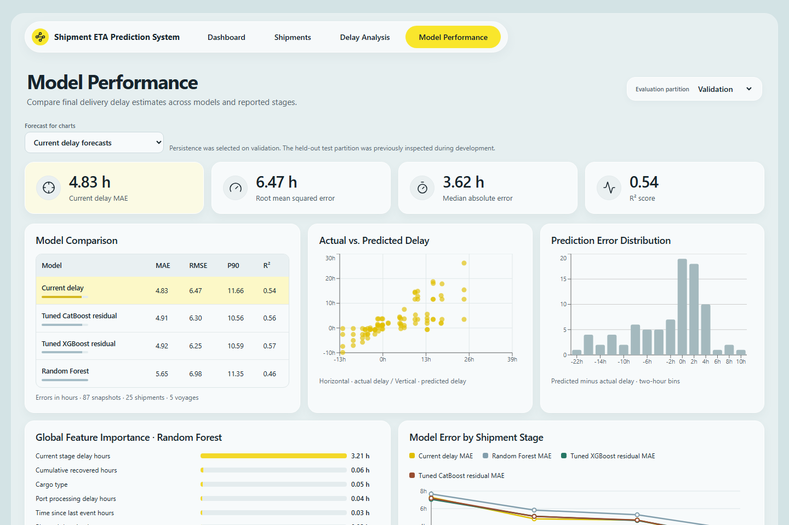

# Shipment ETA Prediction System

Receivers plan trucks, warehouse slots and staffing around a booked delivery time. A late sailing can shift that schedule, while faster port handling or customs clearance can recover lost time. This application replays 50 held-out synthetic shipments and revises their final inland ETA as tracking reports arrive. All times are UTC.

The four tabs connect fleet monitoring (**Dashboard**), individual forecasts and explanations (**Shipments**), stage-wise changes, routes and congestion (**Delay Analysis**), and saved validation and test results (**Model Performance**). Each forecast reports a signed delay and a qualitative risk band. Replay keeps future events hidden and identifies gaps in the tracking history.

## Project layout

```text
Shipment ETA Prediction System/
├── data/              Bookings, reports, ground truth, as-of snapshots and split manifest
├── models/            Saved models, frozen selection, predictions and evaluation metrics
├── src/
│   ├── backend/       FastAPI endpoints and replay service
│   ├── data_generation/  Simulator, observation rules and shared feature construction
│   └── ml/            Forecasting, evaluation and model explanations
├── frontend/          React application, component tests and Playwright scenarios
├── scripts/           Dataset checks, analysis and report tools
├── tests/             Python tests for data, inference and the API
├── reports/           Technical PDF, figures, screenshots and verification records
├── DEMO_GUIDE.md      Five-minute interview walkthrough
└── requirements-tuning.txt   Python dependency entry point, including both boosters
```

## Prerequisites

The submission was verified with **64-bit Python 3.11.5**, **Node.js 22.17.1** and **npm 10.9.2**. Put the intended Python 3.11 interpreter on PATH before creating the environment. Python requirements pin scikit-learn 1.4.2, NumPy 1.26.4, pandas 2.2.3, FastAPI 0.133.0, XGBoost 2.1.4 and CatBoost 1.2.8. The frontend lockfile includes React 18.3.1, TypeScript 5.8.3 and Vite 6.4.1. Initial installation requires package-registry access or a populated cache.

## Start on Windows (PowerShell)

1. Download **Shipment ETA Prediction System.zip**. From the folder containing the ZIP, extract it. For a Git checkout, copy the repository's actual clone URL and use the alternative below.

   ```powershell
   Expand-Archive -LiteralPath '.\Shipment ETA Prediction System.zip' -DestinationPath .
   ```

   ```powershell
   $repoUrl = Read-Host 'Repository clone URL'
   git clone $repoUrl 'Shipment ETA Prediction System'
   ```

2. Open the extracted or cloned project in **terminal A**.

   ```powershell
   Set-Location -LiteralPath '.\Shipment ETA Prediction System'
   ```

3. Check the interpreter version and create an isolated environment.

   ```powershell
   python --version
   python -m venv .venv
   ```

4. Activate it.

   ```powershell
   .\.venv\Scripts\Activate.ps1
   ```

5. Install the pinned Python dependencies and check their compatibility.

   ```powershell
   python -m pip install -r requirements-tuning.txt
   python -m pip check
   ```

6. Verify the supplied models load and reproduce the archived forecasts.

   ```powershell
   python -m pytest -q tests/test_forecast_models.py
   ```

7. Start FastAPI. Leave **terminal A** running. The API documentation is available at [localhost on port 8036](http://127.0.0.1:8036/docs).

   ```powershell
   python -m uvicorn backend.main:app --app-dir src --host 127.0.0.1 --port 8036
   ```

8. Open **terminal B** in the project folder (where `README.md` is visible) and enter the frontend directory.

   ```powershell
   Set-Location -LiteralPath frontend
   ```

9. Check Node and npm, then install the locked dependencies.

   ```powershell
   node --version
   npm.cmd --version
   npm.cmd ci
   ```

10. Start Vite and leave **terminal B** running. It forwards browser requests under `/api` to FastAPI.

    ```powershell
    $env:SHIPMENT_API_ORIGIN = 'http://127.0.0.1:8036'
    npm.cmd run dev -- --host 127.0.0.1 --port 5236 --strictPort
    ```

11. Open the [Dashboard](http://127.0.0.1:5236/dashboard) in a browser.
12. Open **Shipments**, select **Delay amplification · SHP0218** and advance from port arrival to port processing. The predicted delay increases from +0.56 h to +6.73 h. Use Ctrl+C in both terminals when finished.

### macOS and Linux shell equivalents

From the directory containing the ZIP, use the following in terminal A. If using a Git checkout, begin at the project folder and skip extraction.

```sh
unzip 'Shipment ETA Prediction System.zip'
cd 'Shipment ETA Prediction System'
python3.11 -m venv .venv
. .venv/bin/activate
python -m pip install -r requirements-tuning.txt
python -m pip check
python -m pytest -q tests/test_forecast_models.py
python -m uvicorn backend.main:app --app-dir src --host 127.0.0.1 --port 8036
```

From the project root in terminal B, run:

```sh
cd frontend
npm ci
SHIPMENT_API_ORIGIN=http://127.0.0.1:8036 npm run dev -- --host 127.0.0.1 --port 5236 --strictPort
```

### Troubleshooting

- **Python module or model-loading error.** Run `python --version` and `python -m pip check` in terminal A. Install from `requirements-tuning.txt` using the project environment. If PowerShell blocks activation, use `.\.venv\Scripts\python.exe` in place of `python` for each remaining command. For a hash mismatch or missing artifact, restore the complete `models/` directory from the submission ZIP and repeat step 6.
- **Port already in use.** Stop the previous server in its terminal or choose a free port. If changing the API port, set `SHIPMENT_API_ORIGIN` to the new API address before restarting Vite. If changing the Vite port, open that port in the browser.
- **Dashboard fails to load data.** Check the [API health endpoint](http://127.0.0.1:8036/api/health), the Vite proxy address and the backend terminal. A fresh extraction must include both `data/` and `models/`.

## Dataset and replay

The synthetic cohort contains 250 consignments on 50 voyages and five routes. Shipments on a sailing share departure, ocean conditions and port congestion. Handling, customs and inland travel can vary by shipment. The simulator retains physical delivery as ground truth even when an intermediate tracking message is delayed or missing. The current application reads the supplied data and forecasts.

Final delay equals actual minus scheduled inland delivery. Change in deviation equals the current reported deviation minus the previous reported deviation. A positive change adds delay and a negative change recovers time. The 28 inputs use only reports and sensors released by the replay clock. Earlier delivery labels must be available before a later partition begins, and all shipments from each voyage share one partition. The training cohort contains 35 voyages. [Dataset audit](reports/dataset_validation.md) · [Feature schema](data/metadata/feature_schema.json) · [Split manifest](data/processed/split_manifest.csv)

## Application screenshots

| Dashboard | Shipments |
|---|---|
|  |  |

| Delay Analysis | Model Performance |
|---|---|
|  |  |

## Walk through a shipment

[Interview walkthrough](DEMO_GUIDE.md) · [Final acceptance checklist](reports/final_submission_checklist.md)

1. **Dashboard.** Select an attention-list shipment to inspect the evidence, or open the Shipments tab for the three guided replays. The attention rule flags a predicted delay above two hours, an increase in deviation, or a confirmed gap.
2. **Shipments.** Choose **Delay amplification · SHP0218**. The demo sets the clock to its first released report. Advance to port arrival and then port processing. The 6.17 h increase moves the ETA from 02:50 to 09:00 UTC on July 8. Under **Why This ETA?**, inspect the measured intervals and switch between comparative forecasts. Changing this selector leaves the issued operational ETA in place.
3. **Delay Analysis.** Follow the shipment’s propagation link. Inspect report-by-report revisions and the release cutoff. Switch the fleet relationship to compare recovery, route variation or missing tracking. The what-if control creates a hypothetical next interval from the same visible state.
4. **Completed journey.** Choose **Reveal completed history** for actual delivery and the full physical ledger. Return to replay to hide it. For different evidence, **SHP0236** shows partial customs recovery and **SHP0238** spans two missing intermediate reports.
5. **Model Performance.** Select validation or held-out test, and choose a model for the charts. The test partition was previously inspected during development. The demonstrations were selected after the model was frozen.

[Demonstration guide with exact report and outcome clocks](reports/demonstration_guide.md) · [Three-page technical report](<reports/Shipment ETA Prediction System - Technical Report.pdf>) · [Architecture and API](reports/architecture.md)

## Final prediction and risk

**Current-delay persistence** adds the latest reported deviation to the booked final delivery. Positive delay means late. A missing anchor falls back to zero. ETA is rounded to whole seconds. Only a released pre-delivery milestone issues a forecast. The qualitative risk bands use predicted delay: Low at or below 2 h, Moderate above 2 h through 6 h, and High above 6 h. These thresholds give no probability of late delivery.

The original Random Forest and tuned residual XGBoost and CatBoost run on the same 28 point-in-time features. Each residual model adds its estimated remaining change to the observed deviation once. Forest decision-path contributions and native booster SHAP values describe associations in the fitted model. Evidence from a missing input is explicitly marked as imputed. Only intervals with both reports can establish the observed handling or customs duration. A net change across a tracking gap cannot be assigned to an individual stage.

## Frozen evaluation

Each cell shows validation / held-out test. Errors are hours. The first cohort has 87 reports from 25 shipments on five voyages. The second has 175 reports from 50 shipments on ten voyages.

| Model | MAE | RMSE | R² | P90 absolute error | Severe shortfall |
|---|---:|---:|---:|---:|---:|
| Persistence (operational) | 4.829 / 3.619 | 6.466 / 5.306 | .540 / .158 | 11.657 / 8.388 | 6.580 / 8.665 |
| Original Random Forest | 5.650 / 3.976 | 6.978 / 5.392 | .464 / .131 | 11.354 / 7.839 | 6.302 / 8.138 |
| Tuned XGBoost residual | 4.924 / 3.863 | 6.249 / 5.143 | .570 / .209 | 10.590 / 8.424 | 5.523 / 6.925 |
| Tuned CatBoost residual | 4.912 / 3.786 | 6.297 / 5.163 | .564 / .203 | 10.557 / 7.943 | 5.743 / 7.645 |

Severe shortfall averages max(actual delay − forecast delay, 0) when final delay exceeds six hours. Persistence had the lowest validation MAE and was frozen before the final test comparison. Tuned XGBoost reduced RMSE and severe underprediction on both cohorts. The [model comparison report](reports/model_comparison.md) links the release decision to all nine archived candidates, accuracy windows, stage scores, plots and shipment-weighted results.

The cohorts are synthetic. Reports within a voyage are correlated, and only 11 validation shipments and 10 test shipments finished more than six hours late. The held-out R² of 0.158 indicates limited explained variance. Future disruptions can occur after the latest available report. Wider validation needs fresh voyages with real carrier reporting lags, missing messages and independently measured arrival outcomes.

## Verification

Activate the project virtual environment from the root to place its Python first on PATH. Playwright launches its own API on 8014 and web server on 5184. To check the application already running on 5236, set `$env:SHIPMENT_E2E_BASE_URL = "http://127.0.0.1:5236"` before running Playwright.

```powershell
.\.venv\Scripts\python.exe -m pytest -q
$env:Path = (Resolve-Path .venv\Scripts).Path + ";" + $env:Path
cd frontend
npm.cmd test
npm.cmd run typecheck
npm.cmd run lint
npm.cmd run build
npx.cmd playwright install chromium --only-shell
npx.cmd playwright test
```

The dataset reproducibility tests write only temporary comparison files. `python scripts/demonstrations.py` verifies demo forecasts and rebuilds their guide. `python scripts/technical_report.py` renders the technical PDF. Neither operation fits a model.
