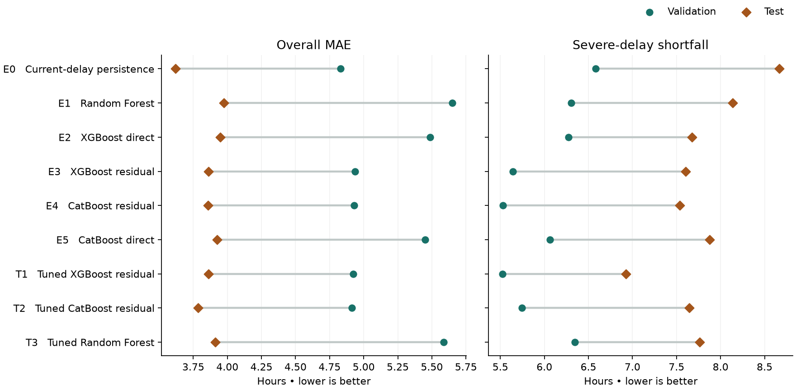
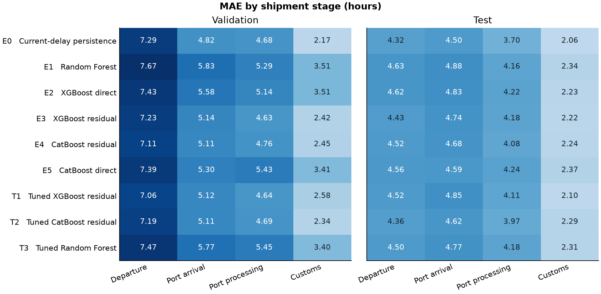

# Tuning Comparision

## Model decision

**Current-delay persistence (E0)** had the lowest MAE on both splits, 4.829 h on validation and 3.619 h on test. The best tuned model by MAE was residual CatBoost (4.912 h and 3.786 h). None of the tuned models qualified for final integration under the existing selection rule.

Tuned residual XGBoost produced the smallest mean severe-delay shortfall on both splits. Compared with persistence, it reduced that shortfall from 6.580 to 5.523 h on validation and from 8.665 to 6.925 h on test. Its overall MAE increased by 0.095 h and 0.244 h, respectively. Persistence remains the offline accuracy benchmark. Its severe-delay shortfall limits its use for delay alerts.

**The held-out test set was previously inspected in the project.** Its results describe a fixed historical cohort. The validation cohort contains only five voyages, and repeated forecasts on the same voyage are correlated. Differences of a few tenths of an hour have limited evidence of generalizability.



## Evaluation protocol

The original manifest assigns 35 voyages (175 shipments, 665 snapshots) to training, 5 voyages (25 shipments, 87 snapshots) to validation and 10 voyages (50 shipments, 175 snapshots) to test. Voyages and shipments are disjoint across splits. All ten original dataset and metadata file hashes were verified.

Each Optuna study completed 100 TPE trials with seed 42, 16 startup trials, a single worker and no pruning. The objective was snapshot-weighted MAE pooled across three later, nonoverlapping five-voyage blocks (287 out-of-fold snapshots). Each fold fitted its own imputer and categorical encoder using only its fitting rows.

Each booster monitored MAE on five preceding voyages with patience 16. It then refitted on all earlier voyages at its chosen tree count before predicting the outer block. The full-training refit used the median tree count from the winning trial's three folds. Random Forest used bounded tree counts and leaf sizes, with bootstrap sampling. Each earlier group’s latest final-delivery report had to be available before the earliest scheduled or actual departure in the next group. The same cutoff check guarded the train/validation and validation/test boundaries.

| Fold | Inner fit voyages | Early-stop voyages | Outer score voyages | Outer rows | Last refit label (UTC) | First score start (UTC) |
| --- | --- | --- | --- | --- | --- | --- |
| 1 | 15 | VG016–VG020 | VG021–VG025 | 95 | 2025-03-23T23:24:02 | 2025-04-04T06:00:00 |
| 2 | 20 | VG021–VG025 | VG026–VG030 | 95 | 2025-04-13T04:34:14 | 2025-04-26T05:37:55 |
| 3 | 25 | VG026–VG030 | VG031–VG035 | 97 | 2025-05-07T20:26:44 | 2025-05-18T05:06:25 |

Residual regressors predict final delay minus the latest observed stage delay. Inference adds that observed delay back once, with zero as the missing-value fallback. The direct forest predicts final delay. All candidates use the original 28-column feature contract. The E-series models below are the archived Phase 2.1 comparators.

## Optimization results

Both boosters searched depths 2–5, learning rates 0.015–0.14 (log), 80–240 trees in steps of 40 and row fractions 0.65–1. XGBoost also varied child weight 2–18, L1 0.01–3 (log), L2 0.3–20 (log) and column fraction 0.5–1. CatBoost used depthwise growth, leaf size 3–20, L2 0.5–20 (log), Bernoulli sampling and feature fraction 0.55–1. The forest searched 60–180 trees in steps of 20, depth 3–12, leaf size 2–18, feature fraction 0.4–1 and row fraction 0.6–1.

| Candidate | Best trial (zero-based) | CV MAE (h) | Trees per fold | Final trees | Best parameters |
| --- | --- | --- | --- | --- | --- |
| Tuned XGBoost residual | 61 | 3.4455 | 1, 17, 42 | 17 | [T1 best.json](../models/tuning/T1/best.json) |
| Tuned CatBoost residual | 52 | 3.4453 | 1, 10, 24 | 10 | [T2 best.json](../models/tuning/T2/best.json) |
| Tuned Random Forest | 93 | 4.2331 | 80, 80, 80 | 80 | [T3 best.json](../models/tuning/T3/best.json) |

## Selection and freeze

A learned candidate had to lower validation MAE and have no greater mean severe-delay shortfall than persistence. Eligible candidates were ranked by MAE, shortfall, RMSE, P90 and candidate ID, in that order. All model artifacts were hashed at selection. The selected artifact was copied, and its SHA-256 was verified before and after test evaluation. The inference replay reconstructed all validation and test inputs from released events and produced the same predictions as the stored snapshots within 0.000001 h.

The selection was frozen at 2026-11-11T16:41:02.127249+00:00. Test scoring began at 2026-11-11T16:41:14.097609+00:00. The selected SHA-256 on both splits was `0abb80a17ca886582b3fccdbd756f988cb587320a300b38d6fbc4591dc81f993`. [Freeze record](../models/tuning/freeze.json) · [Test evaluation record](../models/tuning/test/evaluation_record.json)

## Candidate comparison

Errors are in hours. R² measures explained variance in signed final delay. P50 and P90 are absolute-error percentiles. Median signed error uses predicted minus actual. Shortfall is the mean of max(actual − predicted, 0) over snapshots with actual final delay strictly above 6 h. A forecast above the actual delay contributes zero. Tolerance percentages include the boundary.

### Validation

87 snapshots, 25 shipments and 5 voyages. The severe cohort contains 36 snapshots from 11 shipments on 4 voyages.

| Candidate | MAE | RMSE | R² | P50 | P90 | Median signed | Severe shortfall |
| --- | --- | --- | --- | --- | --- | --- | --- |
| E0 · Current-delay persistence | 4.829 | 6.466 | 0.540 | 3.619 | 11.657 | 1.119 | 6.580 |
| E1 · Random Forest | 5.650 | 6.978 | 0.464 | 4.953 | 11.354 | 1.381 | 6.302 |
| E2 · XGBoost direct | 5.486 | 6.880 | 0.479 | 4.674 | 11.534 | 1.068 | 6.274 |
| E3 · XGBoost residual | 4.935 | 6.296 | 0.564 | 3.935 | 10.652 | 1.345 | 5.644 |
| E4 · CatBoost residual | 4.930 | 6.263 | 0.569 | 4.106 | 10.488 | 1.628 | 5.529 |
| E5 · CatBoost direct | 5.451 | 6.779 | 0.494 | 4.735 | 11.324 | 1.623 | 6.065 |
| T1 · Tuned XGBoost residual | 4.924 | 6.249 | 0.570 | 4.050 | 10.590 | 1.353 | 5.523 |
| T2 · Tuned CatBoost residual | 4.912 | 6.297 | 0.564 | 3.981 | 10.557 | 1.604 | 5.743 |
| T3 · Tuned Random Forest | 5.587 | 6.904 | 0.476 | 4.865 | 11.070 | 1.219 | 6.346 |

| ID | Within ±4 h (%) | Within ±6 h (%) | Within ±8 h (%) | Severe shortfall >4 h (%) | >6 h (%) | >8 h (%) |
| --- | --- | --- | --- | --- | --- | --- |
| E0 | 56.3 | 73.6 | 81.6 | 61.1 | 52.8 | 36.1 |
| E1 | 43.7 | 62.1 | 75.9 | 61.1 | 50.0 | 36.1 |
| E2 | 40.2 | 65.5 | 77.0 | 66.7 | 47.2 | 33.3 |
| E3 | 50.6 | 71.3 | 82.8 | 52.8 | 47.2 | 30.6 |
| E4 | 49.4 | 73.6 | 82.8 | 52.8 | 38.9 | 30.6 |
| E5 | 43.7 | 65.5 | 77.0 | 61.1 | 44.4 | 36.1 |
| T1 | 49.4 | 67.8 | 80.5 | 55.6 | 47.2 | 30.6 |
| T2 | 50.6 | 73.6 | 81.6 | 55.6 | 41.7 | 36.1 |
| T3 | 39.1 | 62.1 | 75.9 | 63.9 | 55.6 | 36.1 |

### Held-out test

175 snapshots, 50 shipments and 10 voyages. The severe cohort contains 35 snapshots from 10 shipments on 5 voyages.

| Candidate | MAE | RMSE | R² | P50 | P90 | Median signed | Severe shortfall |
| --- | --- | --- | --- | --- | --- | --- | --- |
| E0 · Current-delay persistence | 3.619 | 5.306 | 0.158 | 2.545 | 8.388 | 0.852 | 8.665 |
| E1 · Random Forest | 3.976 | 5.392 | 0.131 | 3.106 | 7.839 | 1.493 | 8.138 |
| E2 · XGBoost direct | 3.948 | 5.231 | 0.182 | 3.233 | 8.237 | 1.781 | 7.675 |
| E3 · XGBoost residual | 3.863 | 5.205 | 0.190 | 3.008 | 7.918 | 1.581 | 7.603 |
| E4 · CatBoost residual | 3.857 | 5.186 | 0.196 | 2.890 | 8.076 | 1.692 | 7.536 |
| E5 · CatBoost direct | 3.924 | 5.245 | 0.177 | 2.990 | 8.136 | 1.731 | 7.876 |
| T1 · Tuned XGBoost residual | 3.863 | 5.143 | 0.209 | 3.044 | 8.424 | 1.773 | 6.925 |
| T2 · Tuned CatBoost residual | 3.786 | 5.163 | 0.203 | 2.812 | 7.943 | 1.681 | 7.645 |
| T3 · Tuned Random Forest | 3.913 | 5.209 | 0.189 | 3.118 | 7.755 | 1.652 | 7.765 |

| ID | Within ±4 h (%) | Within ±6 h (%) | Within ±8 h (%) | Severe shortfall >4 h (%) | >6 h (%) | >8 h (%) |
| --- | --- | --- | --- | --- | --- | --- |
| E0 | 75.4 | 84.6 | 89.1 | 77.1 | 65.7 | 54.3 |
| E1 | 65.7 | 81.7 | 90.9 | 74.3 | 57.1 | 42.9 |
| E2 | 65.1 | 81.1 | 89.7 | 68.6 | 54.3 | 42.9 |
| E3 | 65.1 | 82.9 | 90.3 | 77.1 | 54.3 | 40.0 |
| E4 | 66.9 | 82.9 | 89.7 | 68.6 | 54.3 | 42.9 |
| E5 | 64.6 | 81.1 | 89.7 | 74.3 | 60.0 | 45.7 |
| T1 | 67.4 | 79.4 | 89.1 | 54.3 | 48.6 | 42.9 |
| T2 | 66.9 | 85.1 | 90.9 | 71.4 | 54.3 | 42.9 |
| T3 | 65.1 | 81.1 | 91.4 | 74.3 | 54.3 | 42.9 |

## Accuracy by stage and shipment

Each heatmap cell is MAE among the available reports at that stage. Tracking gaps change the number of shipments contributing at later stages. Both panels use the same color scale.



The first four columns below average each shipment’s metrics with equal weight. The final column uses only each shipment’s latest available pre-delivery forecast. Each cell shows validation / held-out test.

| ID | MAE (h) | Within ±4 h (%) | Within ±6 h (%) | Within ±8 h (%) | Last forecast MAE (h) |
| --- | --- | --- | --- | --- | --- |
| E0 | 4.93 / 3.64 | 54.67 / 75.17 | 72.00 / 84.67 | 80.33 / 88.83 | 2.48 / 2.00 |
| E1 | 5.70 / 3.96 | 42.67 / 65.50 | 60.67 / 81.33 | 75.33 / 90.83 | 3.74 / 2.24 |
| E2 | 5.49 / 3.93 | 39.33 / 65.33 | 64.33 / 81.00 | 77.33 / 89.83 | 3.65 / 2.15 |
| E3 | 4.95 / 3.87 | 51.00 / 64.33 | 70.00 / 82.67 | 82.33 / 90.50 | 2.61 / 2.16 |
| E4 | 4.95 / 3.86 | 49.67 / 66.17 | 73.00 / 82.67 | 82.33 / 89.83 | 2.68 / 2.15 |
| E5 | 5.43 / 3.92 | 43.67 / 64.33 | 66.00 / 80.83 | 76.33 / 89.67 | 3.60 / 2.29 |
| T1 | 4.93 / 3.86 | 49.00 / 67.33 | 66.67 / 79.33 | 80.33 / 89.17 | 2.78 / 2.04 |
| T2 | 4.95 / 3.79 | 50.67 / 66.33 | 71.67 / 85.17 | 80.33 / 90.83 | 2.59 / 2.19 |
| T3 | 5.59 / 3.90 | 39.33 / 65.17 | 60.67 / 80.83 | 75.33 / 91.50 | 3.65 / 2.24 |

Stage counts, R², RMSE, percentiles and tolerance accuracy are in the [validation stage file](../models/tuning/validation/by_stage.csv) and [test stage file](../models/tuning/test/by_stage.csv). Per-shipment errors and tolerance accuracy are in the [validation shipment file](../models/tuning/validation/by_shipment.csv) and [test shipment file](../models/tuning/test/by_shipment.csv).

## Files and reproduction

Each of T1, T2 and T3 in [models/tuning](../models/tuning/) contains the fitted pipeline and adapter, full Optuna study, 100-row trial export, best parameters and fold details. Both split folders contain keyed delay predictions, predicted UTC ETAs and complete metrics. The live API still uses its existing Random Forest.

Use Python 3.11 and install `requirements-tuning.txt`. The evaluated environment used Python 3.11.5, scikit-learn 1.4.2, XGBoost 2.1.4, CatBoost 1.2.8 and Optuna 4.5.0. To reproduce from scratch, use a separate copy with an empty models/tuning directory and retain the original data, manifest and comparison artifacts. Run from the project root.

```text
python scripts/tune_models.py
python scripts/evaluate_tuning.py freeze
python scripts/evaluate_tuning.py test
python scripts/report_tuning.py
python -m pytest -q
```
